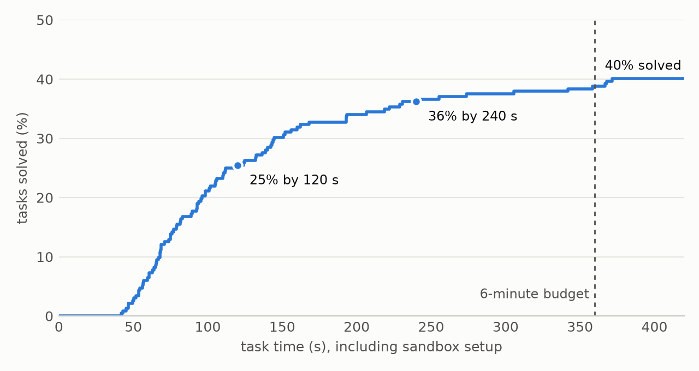
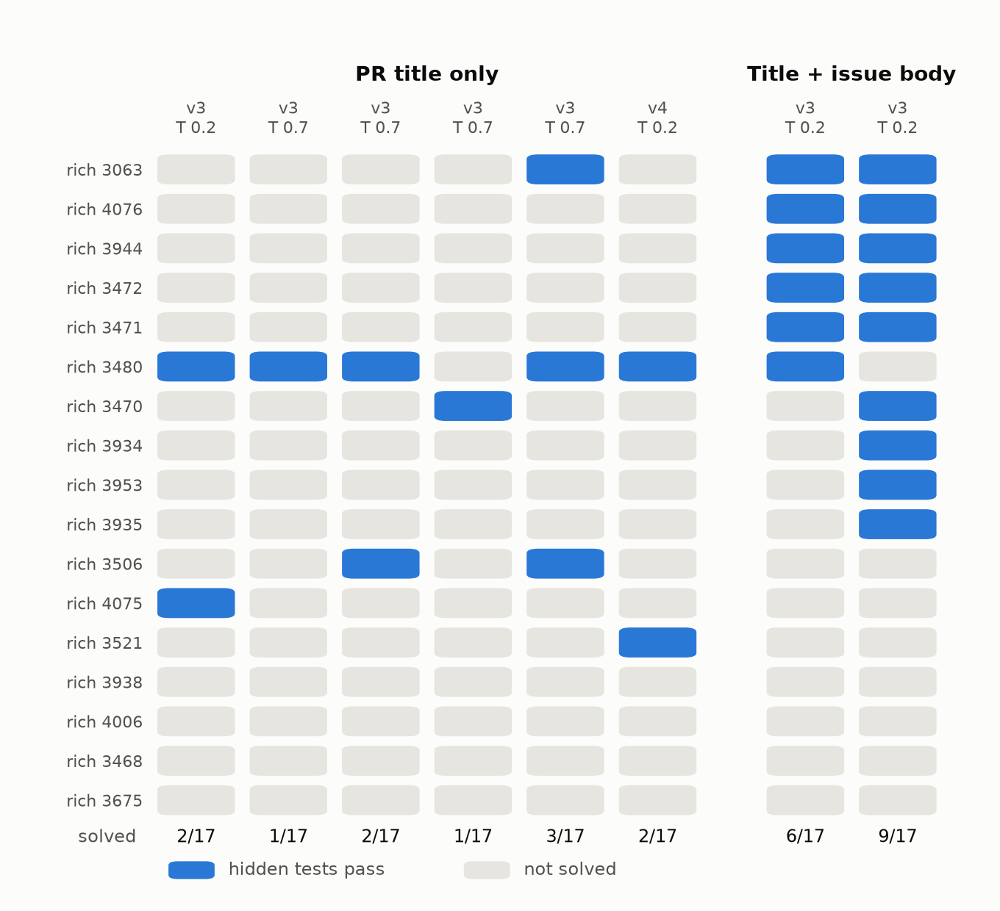

# Tool-Call Mechanics, Stop-Token Supervision and Missing Issue Text: A Failure Analysis of Gemma 4 as a Coding Agent

## Controlled experiments with Gemma 4 as a bug-fixing agent under a fixed per-task budget

**Author:** Shawn Baako, Isometric Partners Lab. Submitted to the Google - The Gemma 4 Developer Agent Paper Track.

## Abstract

We study Gemma 4 (31B int4 and E4B) as an autonomous bug-fixing agent in the competition's official harness, with six minutes and forty tool calls per task, and isolate three causes of lost tasks. (1) Mechanics: a tool-call parser that truncates `edit_file` arguments at an inner quote dropped 34 of 60 edit attempts; three prompt rules cut that to 1 and timeouts from 7 to 1. (2) Stop-token supervision: Gemma 4 ends a tool-call turn by predicting `<|tool_response>`, which a turn-boundary loss mask leaves unsupervised. A LoRA trained that way emitted up to 488 tool calls in one turn and fell from 17 to 8 of 42 tasks. On held-out trajectories its mean stop probability dropped from 1.00 to 0.92; fixing only the mask restored 0.97 and 14 of 42. Of four masking recipes audited, one supervises the stop without also training on tool output. (3) Missing information: tasks whose statement is a bare pull-request title are solved 11% of the time; appending the linked issue body raises that to 44% with no other change, while prompt rules for reproducing the bug or reading tests change nothing. Self-sampled fine-tuning, with the stop fixed, added no solved task. Code, per-task results and a mask checker are released.

## 1. Introduction

The competition asks for an agent built on one Gemma 4 checkpoint that reads a repository, fixes a described issue and submits a patch scored by hidden tests, with 12 hours for about 120 tasks on four L4 GPUs (Markowitz et al., 2026). Our first submission, the 31B checkpoint with a default-like prompt, scored 0.10 on the public leaderboard. This paper asks where the remaining tasks are lost and answers with controlled comparisons on public tasks whose reference patches we verified in the evaluation sandbox.

Contributions:

1. A paired measurement of mechanical losses (parser, timeouts, read mechanics) and of how the agent converts time into solved tasks (Section 3).
2. The `<|tool_response>` stop-token masking defect in Gemma 4 agent fine-tuning: its inference signature, a direct probability measurement, a mask-only ablation, and an audit of common masking recipes with a model-agnostic checker (Section 4).
3. Evidence that self-sampled fine-tuning adds no coverage, on trained tasks and on a held-out repository, and that distilling 31B trajectories into E4B did not help either (Section 5).
4. A controlled demonstration that the dominant residual failure is missing information: the same agent solves four times as many terse-statement tasks when given the issue text, and two behavioral prompt rules do not substitute for it (Section 6).

## 2. Setup

**Harness.** All runs use the competition's official harness, `swegemma` 0.2.11, unmodified. It compiles a candidate into an agent on Google's Agent Development Kit (ADK 1.36.1), which runs the tool-calling loop, and serves the model with vLLM 0.19.1 (Kwon et al., 2023) and its gemma4 tool parser. A candidate is a declarative directory: `agent.yaml`, a system prompt, sampling config, per-task budgets and optionally a LoRA adapter. The agent has shell, file read/edit/write, patch submission and two code-graph tools (`get_code_neighbors`, `search_similar_code`). Reference patches and tests are never visible to the agent or used in training.

**Tasks.** The public release has 129 tasks from four repositories. We ran every reference patch through the sandbox and report results only on tasks where it passes ("gold-valid"). Pool A has 42 tasks (41 from rich, one from fastapi), gold-valid in Kaggle's sandbox. Pool B has 22 fastapi tasks, gold-valid in a Modal sandbox that adds the repository's test dependencies. Solved means the hidden tests pass.

**Budgets and compute.** Unless stated, every run uses six minutes, 40 tool calls, 60 turns, a 512-token thinking budget and temperature 0.2. Section 3 ran on Kaggle's four L4s; later runs used the same harness, vLLM version and sandbox on one Modal H100.

**Statistics.** Each cell is one run unless stated. Differences of two or three tasks on a 42-task pool are within run-to-run noise (four runs of one configuration gave 16, 16, 16, 18), so we draw conclusions from paired mechanism counts, repeated runs and one exact permutation test.

## 3. Mechanical losses and the value of time

Table 1 compares a default-like prompt (v1) with the final prompt (v3) on the 23 gold-valid tasks both ran, under identical budgets except thinking tokens (2048 against 512).

**Table 1. Same 23 tasks, 31B int4, Kaggle L4x4.**

| | v1 | v3 |
|---|---|---|
| solved | 12 | 14 |
| no patch produced | 6 | 1 |
| timeouts | 7 | 1 |
| `edit_file` calls dropped by parser | 34 | 1 |
| `edit_file` calls applied | 24 | 35 |
| unranged file reads | 37 of 166 | 31 of 193 |
| median task time | 313 s | 232 s |

The parser was the largest single mechanism. vLLM 0.19.1's gemma4 parser splits a string argument at an inner double quote or backtick (vLLM issue 39069; issue 39072 reports a similar missing-argument failure in an edit tool), so `old_string` or `new_string` arrives missing, the tool layer rejects the call, and the model resends it. Fifty-six percent of gold-valid tasks need a quote inside the edited text. Two prompt rules removed the loss: write the strings as literal text, and on that error anchor the edit on neighbouring lines without quotes or apply it with a `python3` heredoc. A smaller thinking budget and a rule to make the first edit by the fifteenth call converted most timeouts into submitted patches. The v3 solved set contains v1's plus two tasks. On the public leaderboard, whose tasks come from private repositories, v1 and v3 both scored 0.13: the mechanical gains measured on public tasks did not move the hidden score.

**Time is not the binding constraint.** Figure 2 pools 232 task runs of v3 (both pools, two temperatures). Of the 93 solves, 63% finish within two minutes and 90% within four; the final two minutes of budget add 7%. Sampling diversity is worth more than time: four samples at temperature 0.7 solved 16 to 18 tasks each and 21 of 42 in union.

This holds on public repositories the model has likely seen. A later submission with the same prompt and larger limits (eight minutes, 28 tool calls, 4096 thinking tokens, 8192 output tokens) solved the same 27 of 64 public tasks but scored 0.17 against 0.13 on the hidden private-repository set, a difference of about one standard deviation for a single run.

*Figure 2. Cumulative share of tasks solved against task time, v3, 232 task runs.*

## 4. The stop token

**Data and training.** We sampled the 31B agent itself: four rollouts of pool A at temperature 0.7 plus the Kaggle validation runs, keeping passing trajectories and dropping parser-rejected calls. Round 1 used 54 trajectories over 20 tasks. A rank-16 LoRA (Hu et al., 2022; alpha 32) on all 410 linear projections of the text model was trained for two epochs at learning rate 1e-4 in bf16 and served on the int4 checkpoint. The loss mask covered model-turn tokens only.

**Symptom.** The round 1 adapter fell from 17 to 8 of 42, with 24 tasks producing no patch. In 23 of 1,109 agent turns the model emitted 150 to 488 tool calls, a cycle of one to seven distinct calls, until the output cap; 15 of the 23 were the first turn of the task. The base model never emits more than one call per turn.

**Cause.** Gemma 4's `generation_config` lists three end-of-generation ids: `<eos>`, `<turn|>` and `<|tool_response>`. After a tool call the model predicts `<|tool_response>`; the server stops, runs the tool and appends the result. In a rendered trajectory that token opens the tool-result block, so a mask that supervises model-generated spans ends one token early. Every other token of the turn is trained while about 1,000 stop decisions are not, and training loss looks normal (0.36 to 0.16).

**Measurement.** We teacher-forced ten held-out fastapi trajectories (183 tool calls, no task in any training set) and read the probability of `<|tool_response>` at each stop position (Table 2). The base model stops with probability 1.00. Round 1 prefers another `<|tool_call>` at 10 positions. Retraining on the same data and learning rate with only the mask changed removes most of the drift and most of the runaway turns. Round 2 also drops 48 turns that repeat an earlier call and halves the learning rate; it restores base behavior (0.9998). The mask is therefore the main cause, not the only one.

**Table 2. Stop behavior of 31B adapters. Probabilities on 183 held-out stop positions; outcomes on pool A.**

| | mean P(stop) | stop not top-1 | runaway turns | solved | no patch |
|---|---|---|---|---|---|
| base, v3 prompt | 1.000 | 0 | 0 | 17 | 6 |
| round 1 (turns-only mask) | 0.921 | 10 | 23 | 8 | 24 |
| round 1 data, mask fixed only | 0.973 | 3 | 2 | 14 | 12 |
| round 2 (mask fixed, repeats dropped, lr 5e-5) | 1.000 | 0 | 0 | 14 | 7 |

**Scope.** The same turns-only mask on E4B, with 26 trajectories and 8 optimizer steps, left P(stop) at 0.98 against 0.98 for the base and produced no runaway turn, so the defect needs enough training to surface. Table 3 audits four masking recipes on the same trajectories. Only the prefix-difference mask supervises every stop and no tool output. Unsloth's response-only mask supervises the stop but also all tool output, 81% of its supervised tokens; transformers' assistant-tokens mask, on which TRL's assistant-only loss relies, supervises nothing because the Gemma 4 template has no generation markers. The released `check_stop_supervision.py` reads the generation-end ids of any model and reports stop positions a collator leaves unlabeled.

**Table 3. Tokens supervised by each recipe (183 stops, 16,412 model tokens, 70,579 tool-output tokens).**

| recipe | stops | model tokens | tool output |
|---|---|---|---|
| model turns only (hand-written) | 0 | all | 0 |
| model turns + `<|tool_response>` | 183 | all | 0 |
| assistant span by prefix difference* | all | all | 0 |
| Unsloth `train_on_responses_only` (2026.11.3) | 183 | all | 70,579 |
| transformers 5.17 assistant-tokens mask | 0 | 0 | 0 |

*Measured on the first four trajectories (74 stops).

## 5. What self-sampled fine-tuning changes

**Table 4. Round 2 adapter against the same prompt without it, 31B int4.**

| | pool A (42) | pool B, held-out repository (22) |
|---|---|---|
| base: solved / no patch / timeouts | 17 / 6 / 2 | 10 / 2 / 0 |
| adapter: solved / no patch / timeouts | 14 / 7 / 5 | 10 / 0 / 0 |
| parser-dropped edits | 24 to 14 | 0 to 0 |
| median task time | 174 to 209 s | |

With the stop fixed, the adapter reproduced the properties of its data. Parser losses fell 42% because the filter removed rejected edits, and every pool B task produced a patch. No task was gained: on pool A the adapter's solved set is a subset of the base model's, and longer turns cost three tasks to timeouts. The adapter was evaluated on the tasks it was trained on and still solved fewer of them (14 of 20 against 16), so the null result is not a generalization gap. The base model solves 16 of the 20 tasks that contributed trajectories and 1 of the 22 that did not: self-sampled data covers what the model already does, consistent with the coverage condition of Huang et al. (2024).

**Cross-size distillation.** If coverage is the limit, a student with less coverage than the teacher should gain. We trained E4B on the 31B's round 2 trajectories. Base E4B solves 7 of 64 tasks on pools A and B, where the teacher solves 27. At the learning rate of 31B round 1 (1e-4) the student collapsed into repeating calls across turns (1,166 repeated calls against 93, 31 tasks without a patch, 5 solved); at 5e-5 it was stable and solved 6, with one task gained and two lost. Fifty-five teacher trajectories did not move the student, on trained or untrained tasks, so teacher coverage alone is not sufficient at this data scale.

## 6. The unsolved tasks lack information, not effort

Statement length separates outcomes more sharply than any patch feature. On pool A, v3 solves 3 of 23 tasks whose statement is under 200 characters and 14 of 19 others. The short statements are pull-request titles ("fix for padding width", "preserve newlines") followed by a link to an issue the sandbox cannot fetch. The agent usually opens the right function and submits a patch; the patch fails.

**Two behavioral rules, two nulls.** A rule requiring the agent to reproduce the bug with a script before editing was followed on 20 of 23 terse tasks and solved 3 of 23 (16 of 42 overall). The scripts printed plausible output: the agent could observe behavior but not know which behavior was wanted. A second rule told the agent to find the tests that exercise the named function with `get_code_neighbors` and infer expected behavior from them. It was largely ignored (graph tools called in 3 of 42 tasks, tests read before editing in 5 of 23 terse tasks against 8 without the rule) and solved 3 of 23 (16 of 42). The code graph does link functions to their tests, so this is a compliance failure and leaves the test-oracle idea untested.

**Supplying the information.** For the 20 terse tasks that link a public issue, we fetched the issue body (no comments) and excluded 3 whose body contains lines of the reference patch. On the remaining 17 we appended the body to the statement and changed nothing else. Figure 1 shows every run. Without the issue text, six runs solved 1 to 3 of 17 (11% of task runs); with it, two runs solved 6 and 9 (44%). Seven tasks never solved in six runs were solved with the issue text, four of them in both runs. An exact permutation test that treats the issue label as exchangeable among a task's eight runs gives p = 3e-5. Seven tasks stayed unsolved in both runs: for those, information is not the only limit.

*Figure 1. The 17 terse tasks with a usable linked issue. Columns are runs; the prompt and budget are identical in both groups.*

This reframes Section 5. The tasks self-sampling cannot cover are mostly tasks whose statement omits the expected behavior, so no amount of the model's own passing trajectories contains them. It also bounds what any prompt can do on such tasks, and identifies statement information content as a property a benchmark of this kind should report.

**Process changes, three more nulls.** Three structural changes to the agent left the count on the 64 tasks unchanged: a locating stage that reports candidate code before the coder starts (25), a bundled script that prints a code briefing as the first tool call and runs related tests before submission (26), and a second agent that reviews the diff with a fresh context (26), against 27 for the single agent. The agent used the tools, calling the briefing first in 56 of 64 tasks and the pre-submission check in 49, but edited a file the reference patch touches no more often (47 of 63 tasks against 49). The reviewer changed the patch in 10 tasks; one became a solve and one stopped being one.

## 7. Related work

**Interfaces.** SWE-bench (Jimenez et al., 2024) set the metric. SWE-agent (Yang et al., 2024) showed that the agent-computer interface matters as much as model choice; Table 1 is that finding at the level of tool-call syntax and one parser.

**Self-sampled fine-tuning.** SWE-Gym (Pan et al., 2024) reports that adding a 32B agent's own successful trajectories to its training mixture lowered SWE-bench Lite from 15.3 to 8.7 percent. Yue et al. (2025) show, on single-turn reasoning tasks, that verifiable-reward training narrows rather than extends base-model coverage, and Huang et al. (2024) prove that SFT-based self-improvement is optimal when the initial model has sufficient coverage. SWE-smith (Yang et al., 2025) trains on a stronger teacher's trajectories. Golubev et al. (2025) report the opposite of our result at larger scale: rejection fine-tuning a 72B model on 6,548 of its own successes raised SWE-bench Verified from 11.4 to 20.5 percent before RL added more. Sections 5 and 6 add an agentic instance in which the uncovered region is identified and then closed by supplying information.

**Statement quality.** SWE-bench Verified removed underspecified issues (OpenAI, 2024). SWE-Bench Pro (Deng et al., 2025) found that removing the requirements and interface from its statements cut GPT-5 from 25.9 to 8.4 percent, and Ambig-SWE (Vijayvargiya et al., 2026) that most models struggle to tell underspecified statements from complete ones. Section 6 is the converse intervention on a small model: adding the issue to the same tasks.

**Reproduction.** Reproduce-then-fix is a standard scaffold instruction (Anthropic, 2025). Agentless (Xia et al., 2024) generated reproduction tests for 213 of 300 problems; 94 behaved correctly once the gold patch was applied.

**Stop-token supervision.** End-of-turn tokens outside the supervised span are known from configuration bugs (Axolotl discussion 2259; NVIDIA NeMo Automodel issue 4108). For Gemma 4, TRL issue 7504 records that a tool-call turn ends on `<|tool_response>`, Unsloth PR 12575 addresses training on tool results, and llama.cpp issue 21375 reports tool-call repetition loops with its Gemma 4 parser. We know of no prior measurement connecting the mask boundary at `<|tool_response>` to looping after fine-tuning.

## 8. Limitations and reproducibility

The pools are 42 and 22 tasks from two Python repositories, and most comparisons are single runs. The no-issue runs in Figure 1 mix two temperatures and two prompts. Three linked issues contained the fix and were excluded; the remaining bodies may still hint at it, as real issues do. Issue text is not available to a competition submission, so Section 6 is a diagnosis, not a method. The stop-probability drift is measured on clean contexts and understates the self-reinforcing loops seen at inference. Pool A overlaps the adapter's training tasks; pool B does not. The Modal sandbox for pool B carries extra test dependencies and differs from Kaggle grading. Leaderboard scores are single runs on a 60-task hidden set. E4B also runs this agent loop outside the harness: on a 2016 Tesla P40 with llama.cpp (Gerganov et al.) and the official QAT Q4_0 GGUF it decodes 50 tokens per second, and llama.cpp's parser accepted every quoted `edit_file` call that vLLM's dropped.

All numbers come from the harness's `run_results.jsonl` and trace files. The public repository (https://github.com/shawnbaako/gemma4-agent-failure-analysis) contains the training script with the corrected mask, the trajectory filter, the Modal rollout runner, the stop-token probe and audit, the mask checker, the analysis scripts, and a per-task results table for every run cited here (outcomes and trace counts, no task content). Prompts are quoted where measured; full candidate directories follow after the competition's final deadline. Adapter weights are not released because none improved the solve rate.

## References

- Anthropic. Raising the bar on SWE-bench Verified with Claude 3.5 Sonnet. 2025. https://www.anthropic.com/research/swe-bench-sonnet
- Axolotl discussion 2259. Sample packing masks the `<end_of_turn>` token. 2025. https://github.com/axolotl-ai-cloud/axolotl/discussions/2259
- Deng, X. et al. SWE-Bench Pro: Can AI Agents Solve Long-Horizon Software Engineering Tasks? 2025. arXiv:2509.16941.
- Google. Agent Development Kit (ADK) for Python. https://github.com/google/adk-python
- Gerganov, G. and contributors. llama.cpp. https://github.com/ggml-org/llama.cpp
- Golubev, A. et al. Training Long-Context, Multi-Turn Software Engineering Agents with Reinforcement Learning. 2025. arXiv:2508.03501.
- Hu, E. J. et al. LoRA: Low-Rank Adaptation of Large Language Models. ICLR 2022.
- Huang, A. et al. Self-Improvement in Language Models: The Sharpening Mechanism. 2024. arXiv:2412.01951.
- Hugging Face TRL issue 7504. GRPO ignores the end-of-turn tokens a model declares in its generation config. 2026. https://github.com/huggingface/trl/issues/7504
- Jimenez, C. E. et al. SWE-bench: Can Language Models Resolve Real-World GitHub Issues? ICLR 2024.
- Kwon, W. et al. Efficient Memory Management for Large Language Model Serving with PagedAttention. SOSP 2023.
- llama.cpp issue 21375. Infinite repetition loop in llama-server with peg-gemma4 parser during tool calls. 2026. https://github.com/ggml-org/llama.cpp/issues/21375
- Markowitz, E., Perozzi, B., Rózemberczki, B., Cameron, G., Hemmati, H., Li, Y., Galkin, M., Farhadi, M., Holbrook, R. and Oldacre, A. Google - The Gemma 4 Developer Agent Competition. 2026. Kaggle. https://www.kaggle.com/competitions/gemma-4-developer-agent
- NVIDIA NeMo Automodel issue 4108. ChatDataset never supervises the end-of-turn token for GLM chat templates. 2026. https://github.com/NVIDIA-NeMo/Automodel/issues/4108
- OpenAI. Introducing SWE-bench Verified. 2024. https://openai.com/index/introducing-swe-bench-verified/
- Pan, J. et al. Training Software Engineering Agents and Verifiers with SWE-Gym. 2024. ICML 2025. arXiv:2412.21139.
- Unsloth PR 12575. Studio: stop training Gemma 4 on tool results. 2026. https://github.com/unslothai/unsloth/pull/12575
- Vijayvargiya, S. et al. Ambig-SWE: Interactive Agents to Overcome Underspecificity in Software Engineering. ICLR 2026. arXiv:2502.13069.
- vLLM issue 39069. gemma4_utils._parse_tool_arguments truncates string values containing internal quotes. 2026. https://github.com/vllm-project/vllm/issues/39069
- vLLM issue 39072. Gemma4 on vLLM + PI coding agent: validation failed for tool "edit". 2026. https://github.com/vllm-project/vllm/issues/39072
- Xia, C. S. et al. Agentless: Demystifying LLM-based Software Engineering Agents. 2024. arXiv:2407.01489.
- Yang, J. et al. SWE-agent: Agent-Computer Interfaces Enable Automated Software Engineering. NeurIPS 2024.
- Yang, J. et al. SWE-smith: Scaling Data for Software Engineering Agents. 2025. arXiv:2504.21798.
- Yue, Y. et al. Does Reinforcement Learning Really Incentivize Reasoning Capacity in LLMs Beyond the Base Model? NeurIPS 2025. arXiv:2504.13837.
